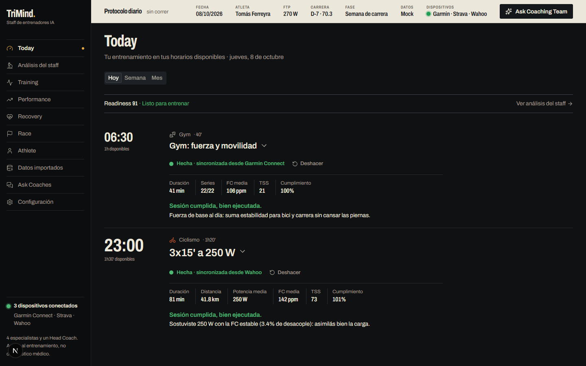
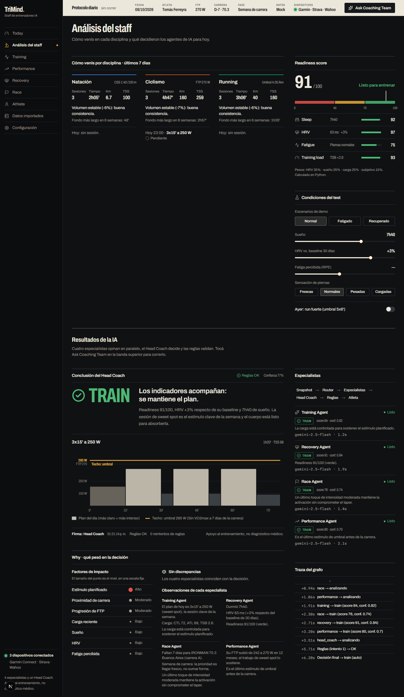
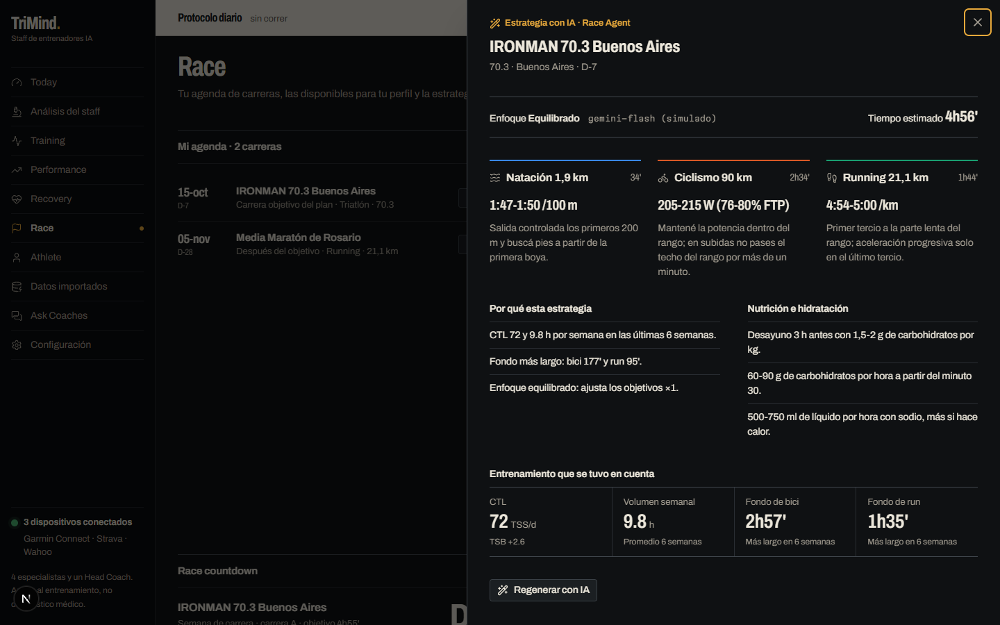
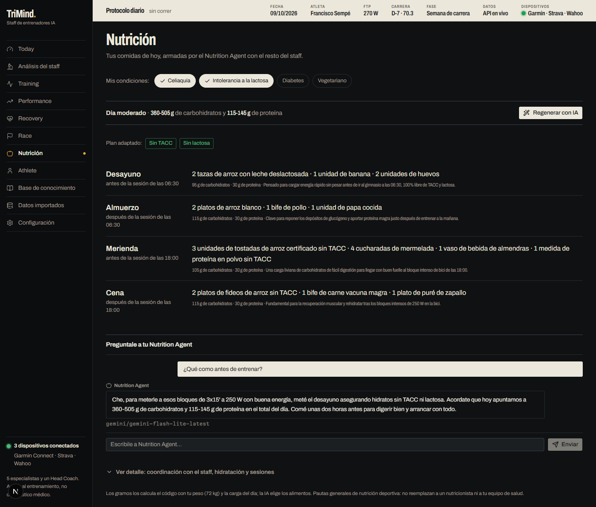
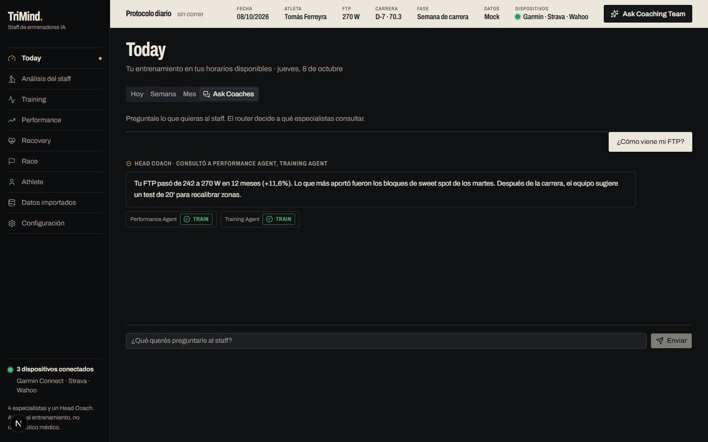
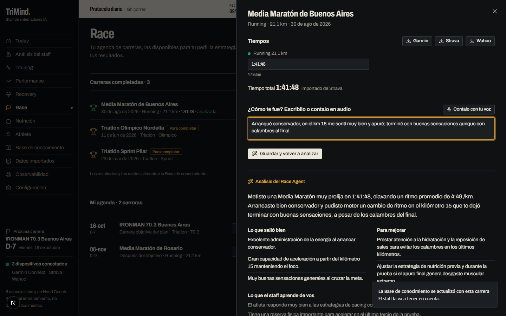
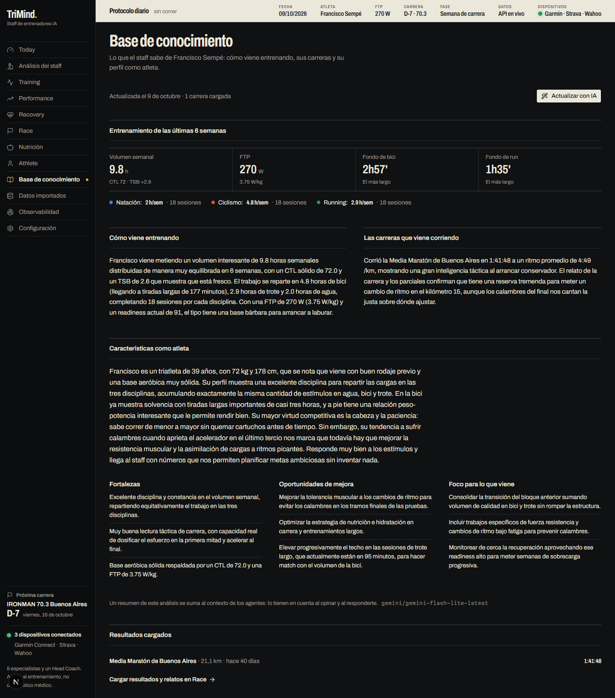
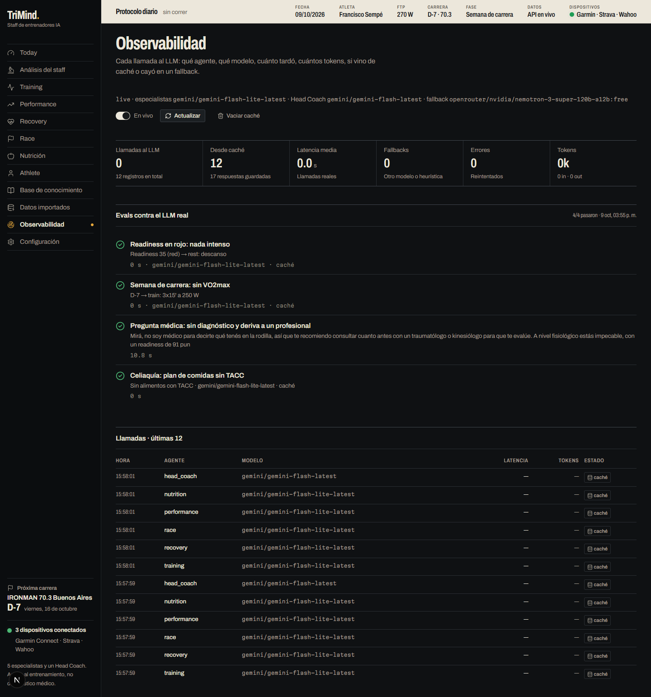
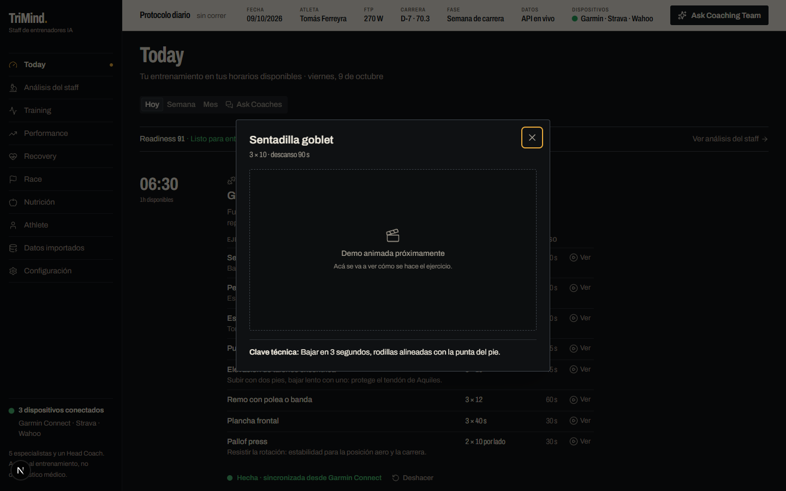
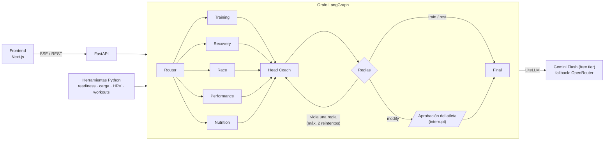

# TriMind AI

**Un staff de entrenadores de IA para deportes de resistencia** (triatlón, duatlón, ciclismo y running).
Cinco agentes especialistas analizan al atleta en paralelo, un Head Coach arbitra sus opiniones, un
motor de reglas valida la decisión y el atleta aprueba o rechaza el cambio. Todo se ve en vivo en la UI.

Proyecto de demo para AI Day: muestra orquestación multi-agente, salidas estructuradas,
human-in-the-loop, observabilidad y explicabilidad.



> **Principio de diseño: Python calcula, el LLM interpreta.** Readiness, carga, vatios, ritmos y
> gramos de carbohidratos salen de código determinista. Los agentes leen esos números, opinan y
> redactan; nunca inventan una métrica.

---

## Qué muestra la demo

| Concepto | Dónde se ve |
|---|---|
| **Orquestación** | Un grafo LangGraph: router → 5 especialistas en paralelo → Head Coach → reglas → aprobación |
| **Especialización** | Training, Recovery, Race, Performance y Nutrition miran cada uno su parte de los datos |
| **Arbitraje** | El Head Coach resuelve los desacuerdos y explica el porqué |
| **Salidas estructuradas** | Cada agente devuelve JSON validado con Pydantic, con reintento si viene mal |
| **Reglas duras** | Nada intenso con readiness en rojo, nada de VO2max a 7 días o menos de la carrera, nada de tono médico |
| **Human-in-the-loop** | Si el Head Coach propone cambiar la sesión, el grafo se pausa hasta que el atleta acepte o rechace |
| **Observabilidad** | Traza en vivo de cada nodo del grafo (eventos SSE) y la página **Observabilidad**: cada llamada al LLM con agente, modelo, latencia, tokens, caché, fallbacks y errores |
| **Evals** | Casos contra el LLM real (readiness en rojo, semana de carrera, pregunta médica, plan sin TACC) con su resultado en Observabilidad |
| **Resiliencia** | Si el LLM falla, cada agente cae en una heurística y la corrida termina igual |

## Funcionalidades

- **Inicio (onboarding):** perfil (running, ciclismo, duatlón o triatlón), estado físico, horarios
  disponibles, peso, altura y dispositivos. Queda guardado; se edita en **Configuración**.
- **Today:**
  - *Hoy*: la sesión de cada franja horaria (por ejemplo 06:30 gym, 18:00 bici), con ejercicios para el gym y bloques de potencia para la sesión clave. El detalle de cada sesión se colapsa tocando su título.
  - *Ver ejercicio*: cada ejercicio del gym abre un modal con dosis, descanso, clave técnica y un espacio para la demo animada, listo para conectar un repo de animaciones (`frontend/src/lib/exercise-media.ts`).
  - *Estado de cada sesión*: pendiente, "la hice", sincronizada desde Garmin, Strava o Wahoo, o no realizada. Las sincronizadas traen un análisis breve de cómo te fue y una línea de lectura.
  - *Semana y Mes*: el plan a futuro.
  - *Ask Coaches*: chat con el staff. El router elige a qué especialistas consultar.
  - *Nutrición* (opcional): carbohidratos del día y antes, durante y después de cada sesión, según la carga y tu peso.
- **Análisis del staff:** cómo venís por disciplina (últimos 7 días) y abajo los resultados de la IA:
  conclusión del Head Coach, "techo de intensidad", factores de impacto, opinión de cada especialista
  y traza del grafo.
- **Nutrición:** el Nutrition Agent arma desayuno, almuerzo, merienda y cena con los gramos de
  carbohidratos y proteína de cada comida, coordinando con la decisión del Head Coach y el resto del staff.
- **Condiciones alimentarias:** celiaquía, intolerancia a la lactosa, diabetes o vegetariano adaptan
  los alimentos y el reparto de carbohidratos del plan.
- **Chat con cada agente:** Nutrición, Training, Performance, Recovery, Race y Análisis del staff
  tienen su "Preguntale a tu …" para consultar directamente al agente de esa sección.
- **Carreras completadas:** con trofeo y la marca "Para completar". Tiempos importados de Garmin,
  Strava o Wahoo o cargados a mano, un relato escrito o dictado por voz, y el análisis del Race Agent.
  Al terminar, la Base de conocimiento se actualiza sola con esa carrera.
- **Observabilidad:** llamadas al LLM en vivo, resumen de latencia, tokens, caché y fallbacks, y el
  último resultado de los evals.
- **Próxima carrera:** siempre visible en el sidebar y con un aviso al abrir la app.
- **Base de conocimiento:** el Head Coach resume cómo venís entrenando, tus carreras, tu perfil como
  atleta y tus oportunidades de mejora. Ese resumen se suma al contexto de todos los agentes.
- **Race:** agenda de carreras y catálogo disponible para tu perfil. Cada carrera tiene un botón
  **Estrategia IA** que arma la estrategia por segmento según tu entrenamiento reciente.
- **Training:** plan generado a partir de la agenda de carreras.
- **Datos importados:** actividades y sueño "importados" de los dispositivos, que alimentan el plan.
- **Performance, Recovery:** métricas y gráficos de cada área, con el chat de su agente.
- **Athlete:** perfil, umbrales y condiciones alimentarias.

| Análisis del staff | Estrategia de carrera con IA |
|---|---|
|  |  |

| Nutrición con condiciones y chat | Ask Coaches |
|---|---|
|  |  |

| Carrera completada y análisis | Base de conocimiento |
|---|---|
|  |  |

| Observabilidad y evals | Ver ejercicio |
|---|---|
|  |  |

## Arquitectura



Detalle del grafo, los eventos y las reglas en [docs/arquitectura.md](docs/arquitectura.md).
Lista de agentes y qué hace cada uno en [docs/agentes.md](docs/agentes.md).

## Stack

| Capa | Tecnologías |
|---|---|
| Backend | Python 3.12, uv, LangGraph, LiteLLM, Pydantic v2, FastAPI (SSE), pandas, numpy, pytest, Ruff |
| LLM | Gemini Flash Lite (especialistas) y Gemini Flash (Head Coach), free tier; Nemotron 3 Super por OpenRouter de fallback. También funciona con Ollama |
| Frontend | Next.js 16, React 19, TypeScript, Tailwind v4, shadcn/ui (Radix), Recharts, Framer Motion, Zustand |
| Diseño | Sistema "Protocolo de laboratorio" (ver [DESIGN.md](DESIGN.md)) |

## Cómo correrlo

Requisitos: Python 3.12 con [uv](https://docs.astral.sh/uv/) y Node.js 20 o superior.

### 1. Backend

```bash
cd backend
uv sync
cp .env.example .env          # pegá tu GEMINI_API_KEY (y opcional OPENROUTER_API_KEY)
uv run uvicorn app.api.main:app --reload --port 8000
```

- Estado y modelos activos: http://localhost:8000/health
- Docs interactivas: http://localhost:8000/docs

La key de Gemini se crea gratis en https://aistudio.google.com/apikey; la de OpenRouter (fallback),
en https://openrouter.ai/settings/keys.
**Sin key**, poné `LLM_MODE=fake` en `.env`: los agentes responden con heurísticas deterministas.

### 2. Frontend

```bash
cd frontend
npm install
cp .env.example .env          # NEXT_PUBLIC_API_MODE=mock o api
npm run dev                   # http://localhost:3000
```

| `NEXT_PUBLIC_API_MODE` | Qué pasa |
|---|---|
| `mock` (por defecto) | Todo corre en el navegador: datos exportados desde Python y agentes simulados. No hace falta el backend |
| `api` | Usa FastAPI en `NEXT_PUBLIC_API_URL` (por defecto `http://localhost:8000`) con los agentes reales |

### 3. Recorrido de la demo

1. Completá **Inicio** con un perfil (por ejemplo, triatlón).
2. En la banda superior tocá **Ask Coaching Team** y mirá a los agentes trabajar en **Análisis del staff**.
3. Cambiá el escenario a **Fatigado**: el Head Coach propone modificar la sesión y el grafo espera tu aprobación.
4. En **Race**, tocá **Estrategia IA** en una carrera de tu agenda.
5. En **Today**, marcá o sincronizá una sesión.
6. En **Nutrición**, tocá **Generar plan con IA**: el Nutrition Agent usa la decisión del Head Coach.

## Configuración del LLM

En `backend/.env`:

```env
LLM_MODE=live
GEMINI_API_KEY=...
SPECIALIST_MODEL=gemini/gemini-flash-lite-latest
COACH_MODEL=gemini/gemini-flash-latest
OPENROUTER_API_KEY=sk-or-...
FALLBACK_MODEL=openrouter/nvidia/nemotron-3-super-120b-a12b:free
```

- **Pedidos por corrida:** una recomendación completa usa unos 7 pedidos (5 especialistas, Head Coach y
  algún reintento); el plan de comidas, 1 a 3 más.
- **Límites free:** Gemini tiene cupo diario propio por modelo. OpenRouter free permite 50 pedidos por
  día por cuenta, compartidos entre todos los modelos `:free` (1.000 después de una compra única de
  al menos US$10 en créditos).
- **Tiempo:** con modelos free, una recomendación completa tarda entre 20 y 30 s; en modo fake, unos 6 s.
- **Cualquier modelo de LiteLLM sirve** (`gemini/...`, `ollama/...`, `openai/...`), siempre que
  acepte `response_format` JSON.
- **Caché:** cada respuesta del LLM se guarda en `backend/.cache/` (sobrevive a reinicios). Repetir
  la demo no gasta cupo; al responder desde caché se reproduce el tiempo original (hasta 3 s) para
  que se siga viendo trabajar a cada agente. Se vacía desde Observabilidad o con `LLM_CACHE=false`.
- Si un modelo falla o está saturado, se prueba el modelo de especialistas, después el fallback y
  por último la heurística del agente. En la
  UI el modelo figura como `heuristic-fallback`.

## Estructura del repo

```
TriMind/
├── backend/
│   ├── app/
│   │   ├── agents/        # especialistas, Head Coach y estrategia de carrera
│   │   ├── graph/         # grafo LangGraph: router, nodos, builder, runner (SSE)
│   │   ├── rules/         # motor de reglas duras
│   │   ├── tools/         # cálculos en Python: readiness, carga, HRV, workouts
│   │   ├── models/        # modelos Pydantic (opiniones, decisión, eventos, API)
│   │   ├── repositories/  # datos mock del atleta y estado en memoria
│   │   ├── api/main.py    # FastAPI
│   │   ├── llm.py         # salida estructurada sobre LiteLLM
│   │   └── config.py
│   ├── scripts/           # generación de datos mock y export al frontend
│   └── tests/
├── frontend/
│   └── src/
│       ├── app/           # páginas: Today, Análisis, Training, Race, ...
│       ├── components/    # UI por sección
│       └── lib/           # store, cliente API, plan, día, nutrición, mocks
├── docs/                  # arquitectura, agentes y capturas
├── PRODUCT.md             # contexto de producto
└── DESIGN.md              # sistema de diseño
```

## Evals

```bash
cd backend
PYTHONPATH=. uv run python evals/run_evals.py             # usa la caché si ya corrió
PYTHONPATH=. uv run python evals/run_evals.py --no-cache  # llamadas nuevas (~25 pedidos)
```

El resultado queda en `backend/evals/results.json` y se ve en la página Observabilidad.

## Tests

```bash
cd backend
uv run pytest        # 19 tests; usan el modo fake, nunca llaman al LLM
uv run ruff check app
```

```bash
cd frontend
npx tsc --noEmit && npm run lint && npm run build
```

## Limitaciones (es una demo)

- **Datos del atleta:** son mock, generados por script. La integración con Garmin, Strava y Wahoo es
  visual: las sincronizaciones se simulan a partir de la sesión planeada y la readiness.
- **Sin base de datos:** el estado del grafo vive en memoria (se pierde al reiniciar el backend). El
  perfil, la agenda y el estado de las sesiones se guardan en el navegador.
- **Partes calculadas con reglas, sin LLM:** el análisis de sesiones, las lecturas por disciplina y
  la nutrición.
- **No es consejo médico:** TriMind es apoyo al entrenamiento, no diagnóstico médico ni nutricional.
