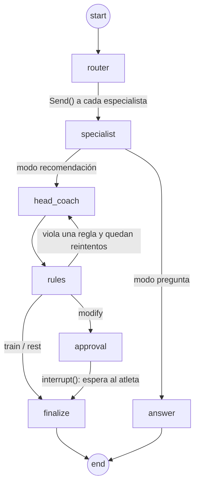

# Arquitectura

## Flujo de datos

1. **Datos del atleta:** historial mock de actividades y bienestar en
   [`backend/data/mock`](../backend/data/mock), generado por `scripts/generate_mock.py`.
2. **Herramientas Python** ([`app/tools/`](../backend/app/tools/)) arman el `AthleteSnapshot` del día:
   - **carga:** CTL, ATL y TSB con EWMA;
   - **HRV:** desvío contra el baseline de 30 días;
   - **readiness:** HRV 35%, sueño 25%, carga 25% y sensación subjetiva 15%. Bandas: rojo menos de 40, ámbar menos de 70, verde 70 o más;
   - **workouts candidatos:** plan, Z2 con estímulos, Z2 suave y descanso.
3. **El grafo** recibe el snapshot. Los agentes solo ven esos números y eligen entre workouts ya
   calculados.
4. **FastAPI** expone el grafo por REST y por SSE; el frontend consume los eventos y anima cada agente.

## Grafo LangGraph

Definido en [`app/graph/builder.py`](../backend/app/graph/builder.py).

| Nodo | Qué hace |
|---|---|
| `router` | Elige especialistas. Hace *fan-out* con `Send` para correrlos en paralelo |
| `specialist` | Corre un especialista y agrega su opinión al estado (reducer de lista) |
| `head_coach` | Arbitra las opiniones y produce un `CoachDraft`. Si viene de una regla violada, recibe el motivo |
| `rules` | Valida la decisión. Hasta `MAX_RULE_RETRIES=2` vuelve al Head Coach; después aplica una alternativa segura |
| `approval` | `interrupt()`: el grafo se pausa con un `thread_id` hasta `POST /recommendation/resume` |
| `finalize` | Arma la `CoachDecision` final con el estado de aprobación |
| `answer` | En Ask Coaches, el Head Coach redacta la respuesta con las opiniones consultadas |

**Checkpointer:** `InMemorySaver`. Los threads pausados se pierden al reiniciar el backend.

## Eventos (SSE)

`GET /recommendation/stream` emite un evento por paso. Los nodos los escriben con
`get_stream_writer()`; los modelos están en [`app/models/events.py`](../backend/app/models/events.py).

| Evento | Cuándo |
|---|---|
| `router_decided` | El router eligió a qué agentes consultar |
| `agent_started` | Arranca un especialista o el Head Coach |
| `agent_completed` | Un agente terminó, con su opinión, modelo y latencia |
| `rules_checked` | Resultado de las reglas, con el número de intento |
| `awaiting_approval` | La decisión es `modify` y el grafo espera al atleta |
| `decision_final` | Decisión final firmada |
| `error` | Algo falló en el grafo |

`awaiting_approval` lo emite el nodo `rules` y no `approval`, porque `approval` se vuelve a ejecutar al
retomar el grafo y duplicaría el evento.

## Capa LLM

[`app/llm.py`](../backend/app/llm.py) hace todas las llamadas por LiteLLM:

1. **Pide JSON** (`response_format: json_object`) y lo valida con el modelo Pydantic del agente.
2. **Si el JSON no valida**, reintenta una vez con el error en el mensaje.
3. **Si el modelo falla** (red, rate limit, modelo no disponible), prueba con `FALLBACK_MODEL`.
4. **Si todo falla**, el agente usa su heurística y la opinión sale con `model: "heuristic-fallback"`.
   La corrida nunca se corta por el LLM.

Las API keys (`OPENROUTER_API_KEY`, `GEMINI_API_KEY`, etc.) se cargan desde `backend/.env` al
arrancar ([`config.py`](../backend/app/config.py)).

## Reglas duras

[`app/rules/engine.py`](../backend/app/rules/engine.py):

| Regla | Condición |
|---|---|
| `red_readiness_high_intensity` | Readiness en rojo y una sesión de sweet spot o más intensa |
| `vo2max_race_week` | VO2max a 7 días o menos de la carrera |
| `medical_tone` | El texto suena a diagnóstico médico (con excepciones para frases seguras) |

## Frontend

- **Cliente único** ([`src/lib/api/index.ts`](../frontend/src/lib/api/index.ts)): `mockApi` o
  `httpApi` según `NEXT_PUBLIC_API_MODE`. El mock emite los mismos eventos que el SSE, con demoras
  realistas, así la demo funciona sin backend.
- **Estado:**
  - `useCoach` ([`store.ts`](../frontend/src/lib/store.ts)): la corrida de agentes, el snapshot y la aprobación;
  - `useSetup` ([`setup.ts`](../frontend/src/lib/setup.ts)): perfil, agenda, horarios y dispositivos, guardado en el navegador;
  - `useSessionLog` ([`session-log.ts`](../frontend/src/lib/session-log.ts)): estado de las sesiones del día.
- **Plan y día:**
  - [`plan.ts`](../frontend/src/lib/plan.ts): fases hacia la carrera objetivo;
  - [`schedule.ts`](../frontend/src/lib/schedule.ts): semanas y meses;
  - [`day.ts`](../frontend/src/lib/day.ts): qué sesión va en cada franja horaria;
  - [`nutrition.ts`](../frontend/src/lib/nutrition.ts): carbohidratos por g/kg según la carga.
- **Tipos:** [`types.ts`](../frontend/src/lib/types.ts) es el espejo de los modelos Pydantic.

## Endpoints

| Método | Ruta | Qué hace |
|---|---|---|
| GET | `/health` | Modo LLM, modelos y agentes activos |
| GET | `/athlete/snapshot` | Métricas del día calculadas en Python |
| POST | `/athlete/state` | Cambia sueño, HRV, RPE, piernas y "run fuerte ayer" |
| POST | `/athlete/scenario/{normal\|fatigued\|recovered}` | Carga un escenario de demo |
| POST | `/recommendation` | Corre el grafo y devuelve la decisión (o la que espera aprobación) |
| GET | `/recommendation/stream` | Lo mismo por SSE, un evento por nodo |
| POST | `/recommendation/resume` | `{thread_id, action: accept\|reject}` retoma el grafo pausado |
| POST | `/race/strategy` | Estrategia por segmento con el Race Strategy agent |
| POST | `/ask` | Pregunta libre: el router elige especialistas y responde el Head Coach |
| POST | `/feedback` | RPE y piernas después de entrenar |
